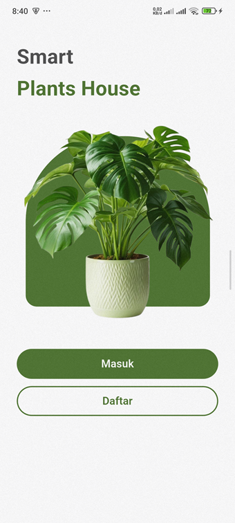
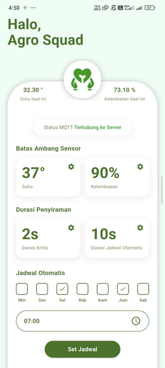
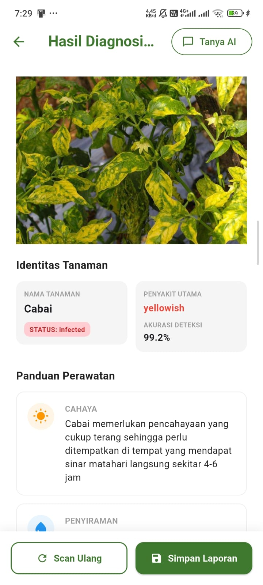
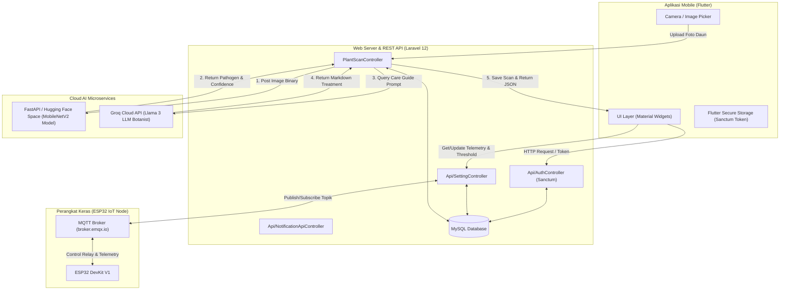

# 📱 OLERICURE Mobile: App Irigasi Presisi & Diagnosis Patogen Daun Olerikultura

[](https://flutter.dev)
[](https://dart.dev)
[](https://android.com)
[](https://apple.com)
[](https://laravel.com)
[](https://laravel.com/docs/sanctum)
[](https://mqtt.org)
[](https://huggingface.co)
[](https://groq.com)
[](#)

**OLERICURE Mobile** adalah aplikasi *companion* berbasis **Flutter** yang menjadi bagian integral dari ekosistem cerdas **OLERICURE** (*Sistem Irigasi Presisi Berbasis IoT Hibrida dan Diagnosis Patogen Daun Olerikultura Menggunakan Cloud-Based Inference MobileNetV2 Terintegrasi Large Language Model*).

Aplikasi ini memungkinkan petani/pengguna untuk memantau kondisi telemetri tanaman secara *real-time*, mengontrol irigasi dari mana saja, memindai penyakit daun tanaman hortikultura (olerikultura) dengan kamera HP, serta berkonsultasi langsung dengan **AI Botanist Chatbot**.

---

## 🔗 Ekosistem Repository & Link Terkait

Sistem OLERICURE dikembangkan secara terintegrasi dalam beberapa komponen repository dan tautan server:

* 📱 **Aplikasi Mobile Repository (Repo Ini / Flutter App):**  
  [`https://github.com/Lesmana24/Olericure-Mobile`](https://github.com/Lesmana24/Olericure-Mobile)
* 🌐 **Live Website Production:**  
  [`https://agrosquad.page.gd`](https://agrosquad.page.gd)
* 💻 **Web Server & Backend REST API Repository:**  
  [`https://github.com/Lesmana24/Olericure`](https://github.com/Lesmana24/Olericure)
* 🧠 **AI Diagnostics Microservice (FastAPI on Hugging Face):**  
  [`https://lesmana24-agrosquad-ai.hf.space/diagnosa`](https://lesmana24-agrosquad-ai.hf.space/diagnosa)

---

## 🔥 Fitur Utama Aplikasi Mobile

### 1. 🔐 Autentikasi Terenkripsi (Laravel Sanctum API)
- Register & Login akun pengguna dengan enkripsi token Sanctum.
- Penyimpanan token aman (*Secure Token Storage*) menggunakan `flutter_secure_storage` & `shared_preferences`.
- Sistem proteksi sesi otomatis dan penanganan *rate-limiting* (throttle 5x coba/menit).

### 2. 📊 Real-Time IoT Telemetry & Control (Home Dashboard)
- **Monitoring Suhu & Kelembapan:** Memantau telemetry lingkungan (Suhu °C & Kelembapan Tanah/Udara %) secara *real-time*.
- **Status Perangkat ESP32:** Indikator visual koneksi hardware (Online/Offline).
- **Penyiraman Manual:** Tombol eksekusi penyiraman jarak jauh berbasis pemicu MQTT / HTTP.
- **Dynamic Threshold Modal:** Pengaturan ambang batas suhu dan kelembapan yang dapat diubah langsung dari aplikasi mobile.

### 3. 🍃 AI Leaf Disease Scanner (MobileNetV2 Computer Vision)
- **Kamera & Galeri:** Mengambil foto daun tanaman secara langsung via kamera (`camera`) atau dari galeri (`image_picker`).
- **Cloud-Based Inference:** Mengirim foto ke microservice AI (FastAPI Hugging Face) yang menggunakan arsitektur **MobileNetV2**.
- **Hasil Presisi:** Menampilkan nama penyakit tanaman, diagnosis patogen, status kesehatan, dan persentase skor akurasi (*confidence score*).

### 4. 🤖 Generative AI Plant Care Guide & Botanist Chatbot (Groq Llama 3)
- **Rekomendasi Perawatan Tergeneratif:** Panduan kebutuhan cahaya (*care_light*), takaran air (*care_water*), suhu ideal (*care_temperature*), serta langkah penanganan penyakit berbasis **Groq Llama 3 LLM**.
- **Botanist Chatbot Interaktif:** Asisten AI cerdas untuk berkonsultasi dan bertanya lebih lanjut seputar tanaman dengan dukungan *Rich Markdown Rendering* (`flutter_markdown`).

### 5. 🔔 Log Riwayat & Notification Center
- **Riwayat Diagnosa AI:** Menyimpan dan menampilkan kembali hasil scan penyakit tanaman yang pernah dilakukan sebelumnya.
- **Log Penyiraman & Notifikasi:** Catatan aktivitas penyiraman otomatis (pemicu sensor vs pemicu jadwal) serta peringatan saat kondisi tanaman abnormal.

---

## 📸 Dokumentasi Visual & Antarmuka Aplikasi

| Halaman Selamat Datang / Splash | Dashboard Utama & Telemetry | Scan AI & Diagnosis Patogen |
|:------------------------------:|:--------------------------:|:--------------------------:|
|  |  |  |

---

## 🏗️ Arsitektur Aplikasi Mobile & Alur Data



---

## 🛠️ Spesifikasi Teknis & Library Stack

| Package / Library | Versi | Fungsi / Kegunaan |
| :--- | :--- | :--- |
| **`flutter`** | SDK ^3.10 | Framework utama pengembangan aplikasi mobile cross-platform |
| **`camera`** | `^0.11.1` | Mengakses modul kamera perangkat untuk pengambilan foto daun |
| **`image_picker`** | `^0.8.8` | Memilih foto tanaman dari galeri perangkat |
| **`http`** | `^1.6.0` | Melakukan HTTP Request REST API ke Laravel Backend |
| **`flutter_secure_storage`** | `^10.0.0` | Menyimpan token autentikasi Sanctum secara terenkripsi |
| **`shared_preferences`** | `^2.5.5` | Menyimpan preferensi dan status login lokal |
| **`mqtt_client`** | `^10.11.11` | Komunikasi protokol MQTT *real-time* dengan hardware ESP32 |
| **`flutter_markdown`** | `^0.7.7+1` | Rendering format Markdown pada balasan AI Botanist Chatbot |
| **`flutter_launcher_icons`** | `^0.13.1` | Generasi otomatis ikon aplikasi Android & iOS (`gambar/logoApp.png`) |

---

## 🌐 Konfigurasi REST API Endpoints

Semua konfigurasi endpoint terpusat pada file [`lib/api_config.dart`](file:///c:/xampp/htdocs/Olericure-Mobile/lib/api_config.dart):

```dart
class ApiConfig {
  static const String BASE_URL = 'https://agrosquad.up.railway.app/api/';
  static const String storageUrl = 'https://agrosquad.up.railway.app/uploads/';
  ...
}
```

### 📋 Daftar Endpoint API yang Digunakan:

| Endpoint | Method | Auth | Keterangan |
| :--- | :---: | :---: | :--- |
| `/api/register` | `POST` | Public | Pendaftaran akun baru pengguna mobile |
| `/api/login` | `POST` | Public | Autentikasi login & generate token Sanctum |
| `/api/logout` | `POST` | Sanctum | Revoke token dan keluar dari akun |
| `/api/settings` | `GET` | Sanctum | Mengambil telemetry suhu & threshold terbaru |
| `/api/update-setting` | `POST` | Sanctum | Memperbarui threshold suhu & kelembapan |
| `/api/ai/upload` | `POST` | Sanctum | Mengunggah foto daun & memicu klasifikasi AI MobileNetV2 |
| `/api/ai/store` | `POST` | Sanctum | Menyimpan laporan hasil diagnosa ke database |
| `/api/mobile-chat` | `POST` | Sanctum | Konsultasi interaktif dengan AI Botanist Chatbot (Groq Llama 3) |
| `/api/ai/history` | `GET` | Sanctum | Mengambil daftar riwayat diagnosa tanaman |
| `/api/ai/history/{id}` | `DELETE` | Sanctum | Menghapus riwayat scan tertentu |
| `/api/notifications` | `GET` | Sanctum | Mengambil log notifikasi dan penyiraman |

---

## 🚀 Panduan Instalasi & Jalankan Aplikasi

### 1. Prasyarat Sistem
- **Flutter SDK:** Versi 3.10.x atau yang lebih baru.
- **Dart SDK:** Versi 3.x.
- **Android Studio / VS Code** dengan ekstensi Flutter & Dart.
- Perangkat Android (OS 5.0 Lollipop+) / iOS (iOS 12+) fisik atau Emulator.

### 2. Langkah-Langkah Clone & Setup

1. **Clone Repository Mobile:**
   ```bash
   git clone https://github.com/Lesmana24/Proyek3-Mobile.git
   cd Proyek3-Mobile
   ```

2. **Install Dependensi Flutter:**
   ```bash
   flutter pub get
   ```

3. **Konfigurasi URL API Backend:**
   Buka file [`lib/api_config.dart`](file:///c:/xampp/htdocs/Olericure-Mobile/lib/api_config.dart) dan sesuaikan `BASE_URL` dengan server Laravel Anda (misal `http://10.0.2.2:8000/api/` untuk Android Emulator atau domain production):
   ```dart
   static const String BASE_URL = 'https://agrosquad.up.railway.app/api/';
   ```

4. **Jalankan Aplikasi (Debug Mode):**
   ```bash
   flutter run
   ```

5. **Build APK Release:**
   ```bash
   flutter build apk --release
   ```
   *File APK hasil build akan berada di `build/app/outputs/flutter-apk/app-release.apk`.*

---

## 👨‍💻 Pengembang & Tim Project

Proyek **OLERICURE** dikembangkan oleh:

* **Lesmana Adhi Kusuma**
* **Genetica Deardi I**
* **Muhammad Nurfaqiih**

*Mahasiswa D3 Teknik Informatika - Politeknik Negeri Indramayu (Polindra)*

---

## 📜 Lisensi

Proyek ini dibuat untuk memenuhi Tugas Proyek 3 Program Studi D3 Teknik Informatika. Hak cipta dilindungi oleh tim pengembang OLERICURE.
